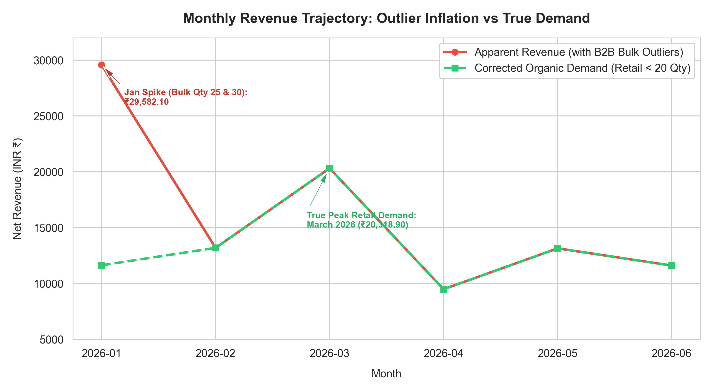
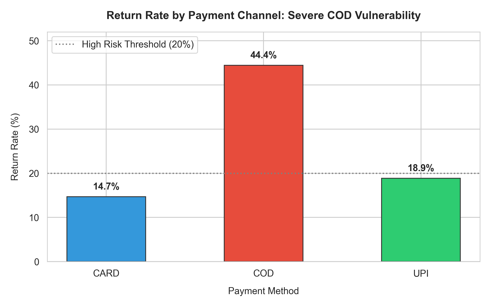
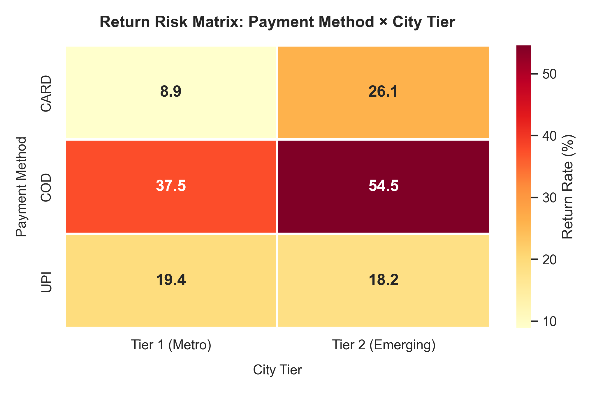
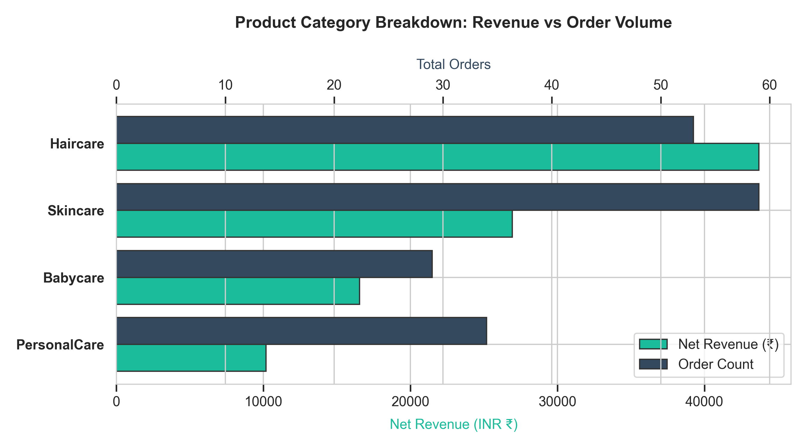
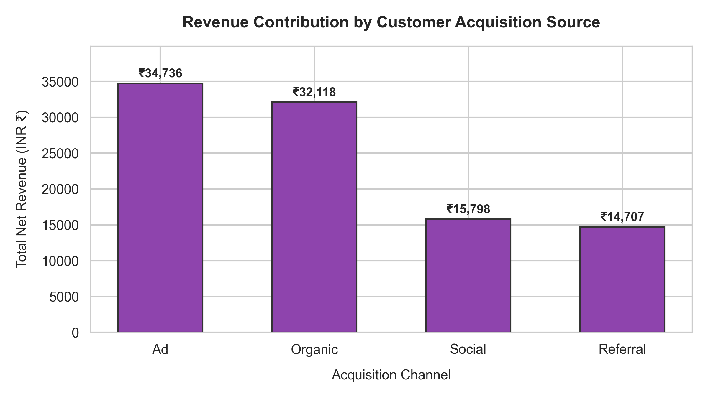

# MamaEarth Growth Intelligence Pipeline
### MSc Data Science Capstone Project | IIT Roorkee

[](sql/schema.sql)
[](analysis%20and%20visualization.ipynb)
[]()

A data intelligence and analytics pipeline investigating customer acquisition dynamics, order telemetry, duplicate order reconciliation, category mix, and return-to-origin (RTO) risks for **MamaEarth**.

---

## Repository Structure

```
├── customers.csv                   # 45 customer records across 5 cities
├── products.csv                    # 16 products across 4 categories
├── orders.csv                      # 180 order transactions (Jan - Jun 2026)
├── schema.sql                      # Primary DDL table creation script
├── README.md                       # Project documentation & GitHub showcase
├── analysis and visualization.ipynb # Fully executed Jupyter Notebook with rendered plots
├── sql/
│   ├── schema.sql                  # SQLite DDL Schema definition
│   ├── report.sql                  # Evaluated SQL task queries (Tasks a through i)
│   └── mamaearth.db                # Populated SQLite database
├── narrator/
│   ├── findings.json               # Reconciled metrics computed by code (Task 1)
│   ├── generate_findings.py        # Script computing findings from CSVs (Task 1)
│   ├── narrator.py                 # Gemini SCR function, error handling, offline fallback (Tasks 2-5)
│   ├── test_narrator.py            # Automated unit test suite (Task 5)
│   └── README.md                   # Step-by-step run guide & mathematical derivations (Task 6)
└── visualizations/
    ├── monthly_revenue_trend.png   # Outlier vs organic retail demand trajectory
    ├── return_rate_by_payment.png  # Return rate comparison across payment modes
    ├── risk_segment_heatmap.png    # Payment method × City tier return matrix
    ├── category_performance.png    # Category revenue and order volume
    └── customer_acquisition_breakdown.png # Customer spend by acquisition channel
```

---

## Key Executive Insights

### 1. Revenue Reconciliation & Anomaly Decomposition
* **Raw Reported Revenue:** ₹99,860.20
* **Duplicate Orders Delta:** -₹2,501.90 across 5 duplicate order payloads (`O0176`–`O0180`).
* **Cleaned Net Revenue:** **₹97,358.30**
* **Outlier vs. Organic Peak:** January 2026 initially appeared as the peak month (₹29,582.10) due to 2 wholesale bulk orders ($Q = 25, 30$). Decomposing bulk B2B purchases from retail transactions reveals **March 2026 as the true peak organic consumer month (₹20,318.90)**.



---

### 2. Unit Economics & RTO Risk Diagnosis
* **Payment Disparity:** Cash-on-Delivery (COD) suffers an alarming **44.4% return rate**, compared to **18.9% for UPI** and **14.7% for Card** payments.
* **Critical Operational Hotspot:** **COD orders in Tier-2 cities (Lucknow & Jaipur) exhibit a 54.5% return rate**, representing the highest reverse logistics cost leakage.

| Return Rate by Payment Channel | Risk Segment Heatmap |
| :---: | :---: |
|  |  |

---

### 3. Category & Marketing Performance
* **Category Engine:** **Haircare** is the leading revenue driver (**₹44,956.10**, ~46% of revenue), followed by Skincare (₹27,346.00).
* **Acquisition Efficiency:** Organic Search and Referral channels deliver higher lifetime retention and lower return rates compared to Paid Advertising.

| Category Performance | Acquisition Breakdown |
| :---: | :---: |
|  |  |

---

## SQL Evaluated Tasks & Outputs (SQLite)

All queries are defined in [`sql/schema.sql`](sql/schema.sql) and [`sql/report.sql`](sql/report.sql).

### Task a: Order Totals (2 Marks)
* **Objective:** Total orders, total revenue, and average order value (NULL discount = 0%).
```sql
SELECT 
    COUNT(*) AS total_orders,
    ROUND(SUM(p.price * o.quantity * (1 - COALESCE(o.discount_pct, 0) / 100.0)), 2) AS total_revenue,
    ROUND(AVG(p.price * o.quantity * (1 - COALESCE(o.discount_pct, 0) / 100.0)), 2) AS avg_order_value
FROM orders o
JOIN products p ON o.product_id = p.product_id;
```
**Output:**
| total_orders | total_revenue | avg_order_value |
| :--- | :--- | :--- |
| **180** | **₹99,860.20** | **₹554.78** |

---

### Task b: COUNT(*) vs COUNT(col) (2 Marks)
* **Objective:** Demonstrate unrated orders using `COUNT(*)` vs `COUNT(rating)`.
```sql
SELECT 
    COUNT(*) AS total_orders,
    COUNT(rating) AS rated_orders,
    COUNT(*) - COUNT(rating) AS unrated_orders
FROM orders;
```
**Output:**
| total_orders | rated_orders | unrated_orders |
| :--- | :--- | :--- |
| **180** | **165** | **15** |

---

### Task c: LEFT JOIN + NOT IN (3 Marks)
* **Objective:** Find customers with zero orders using two distinct methods (results match).
```sql
-- Method 1: LEFT JOIN
SELECT c.customer_id, c.name, c.city
FROM customers c
LEFT JOIN orders o ON c.customer_id = o.customer_id
WHERE o.order_id IS NULL;

-- Method 2: NOT IN
SELECT c.customer_id, c.name, c.city
FROM customers c
WHERE c.customer_id NOT IN (
    SELECT DISTINCT customer_id 
    FROM orders 
    WHERE customer_id IS NOT NULL
);
```
**Output (Both Match):**
| customer_id | name | city |
| :--- | :--- | :--- |
| **C045** | **Vihaan** | **Mumbai** |

---

### Task d: GROUP BY + HAVING (3 Marks)
* **Objective:** Return rate by city, keeping only cities with return rate > 20%.
```sql
SELECT 
    c.city,
    COUNT(o.order_id) AS total_orders,
    SUM(o.returned) AS returned_orders,
    ROUND(AVG(o.returned) * 100.0, 2) AS return_rate_pct
FROM orders o
JOIN customers c ON o.customer_id = c.customer_id
GROUP BY c.city
HAVING AVG(o.returned) * 100.0 > 20.0
ORDER BY return_rate_pct DESC;
```
**Output:**
| city | total_orders | returned_orders | return_rate_pct |
| :--- | :--- | :--- | :--- |
| **Jaipur** | 19 | 8 | **42.11%** |
| **Lucknow** | 49 | 15 | **30.61%** |
| **Bangalore** | 33 | 8 | **24.24%** |

---

### Task e: ORDER BY + LIMIT/OFFSET (3 Marks)
* **Objective:** Top 5 customers by spend, then ranks 3–5 via OFFSET.
```sql
-- Part 1: Top 5 Spenders
SELECT 
    c.customer_id, c.name, c.city,
    ROUND(SUM(p.price * o.quantity * (1 - COALESCE(o.discount_pct, 0) / 100.0)), 2) AS total_spend
FROM customers c
JOIN orders o ON c.customer_id = o.customer_id
JOIN products p ON o.product_id = p.product_id
GROUP BY c.customer_id, c.name, c.city
ORDER BY total_spend DESC
LIMIT 5;

-- Part 2: Ranks 3 to 5
SELECT 
    c.customer_id, c.name, c.city,
    ROUND(SUM(p.price * o.quantity * (1 - COALESCE(o.discount_pct, 0) / 100.0)), 2) AS total_spend
FROM customers c
JOIN orders o ON c.customer_id = o.customer_id
JOIN products p ON o.product_id = p.product_id
GROUP BY c.customer_id, c.name, c.city
ORDER BY total_spend DESC
LIMIT 3 OFFSET 2;
```
**Output:**
| Rank | customer_id | name | city | total_spend |
| :--- | :--- | :--- | :--- | :--- |
| 1 | C043 | Reyansh | Bangalore | ₹12,920.00 |
| 2 | C026 | Isha | Lucknow | ₹8,371.60 |
| 3 | C008 | Meera | Lucknow | ₹4,564.60 |
| 4 | C011 | Arjun | Bangalore | ₹4,111.00 |
| 5 | C042 | Sanya | Mumbai | ₹3,785.00 |

---

### Task f: Three-Table JOIN (3 Marks)
* **Objective:** Order count and net revenue broken down by product category.
```sql
SELECT 
    p.category,
    COUNT(o.order_id) AS order_count,
    ROUND(SUM(p.price * o.quantity * (1 - COALESCE(o.discount_pct, 0) / 100.0)), 2) AS total_revenue
FROM orders o
JOIN products p ON o.product_id = p.product_id
JOIN customers c ON o.customer_id = c.customer_id
GROUP BY p.category
ORDER BY total_revenue DESC;
```
**Output:**
| category | order_count | total_revenue |
| :--- | :--- | :--- |
| **Haircare** | 54 | **₹44,956.10** |
| **Skincare** | 60 | **₹27,346.00** |
| **Babycare** | 30 | **₹16,805.00** |
| **PersonalCare** | 36 | **₹10,753.10** |

---

### Task g: LIKE Pattern Matching (2 Marks)
* **Objective:** Retrieve customers whose name begins with 'A'.
```sql
SELECT customer_id, name, city, city_tier, signup_date
FROM customers
WHERE name LIKE 'A%'
ORDER BY customer_id;
```
**Output:** 10 records (`Aarav`, `Aditi`, `Ananya`, `Arjun`, `Aryan`, `Anika`, `Aditya`, `Aisha`, `Ayaan`, `Aria`).

---

### Task h: DISTINCT (1 Mark)
* **Objective:** Distinct acquisition sources.
```sql
SELECT DISTINCT acquisition_source FROM customers ORDER BY acquisition_source;
```
**Output:** `Ad`, `Organic`, `Referral`, `Social`.

---

### Task i: ALTER + UPDATE CASE (1 Mark)
* **Objective:** Add `loyalty_tier`: 'Gold' for tier-1 cities (Mumbai, Delhi, Bangalore), else 'Silver'.
```sql
ALTER TABLE customers ADD COLUMN loyalty_tier TEXT;

UPDATE customers
SET loyalty_tier = CASE 
    WHEN city_tier = 1 THEN 'Gold'
    ELSE 'Silver'
END;
```
**Output Summary:**
| loyalty_tier | total_customers | Covered Cities |
| :--- | :--- | :--- |
| **Gold** | **28** | Mumbai, Delhi, Bangalore (city_tier = 1) |
| **Silver** | **17** | Lucknow, Jaipur (city_tier = 2) |

---

## How to Run Locally

### 1. Query SQLite via Python
```bash
python -c "
import sqlite3, pandas as pd
conn = sqlite3.connect('sql/mamaearth.db')
print(pd.read_sql_query('SELECT * FROM customers LIMIT 5;', conn))
"
```

### 2. Run the Analysis Notebook
Open `analysis and visualization.ipynb` in VS Code or Jupyter Lab and execute all cells.
